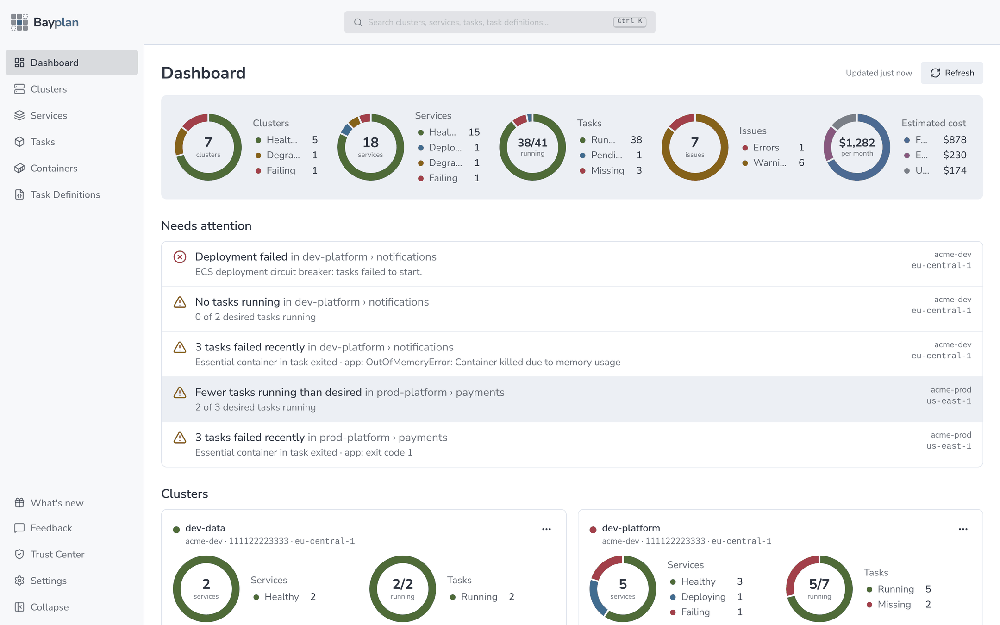
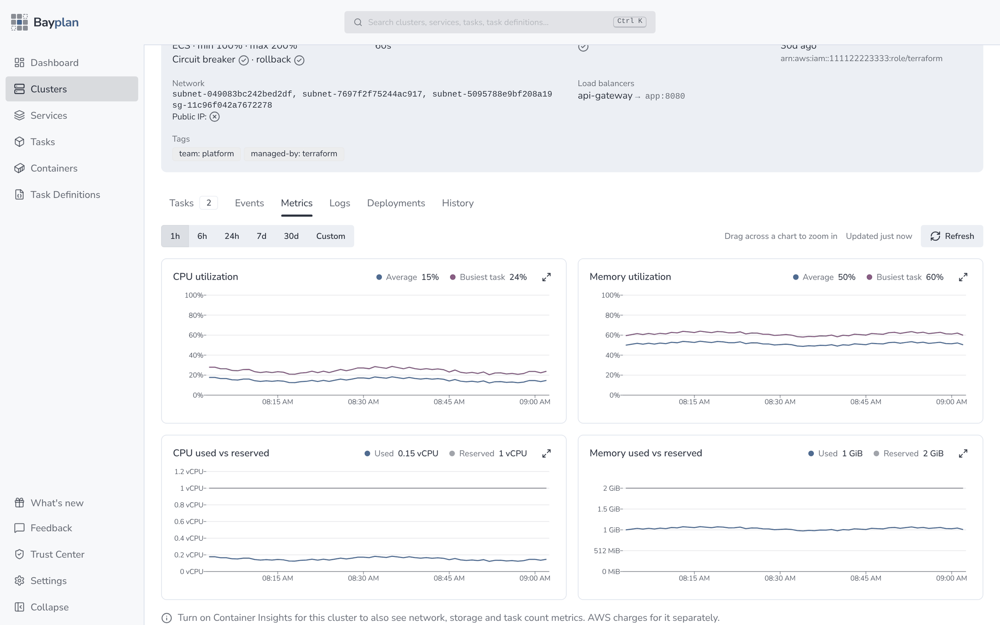
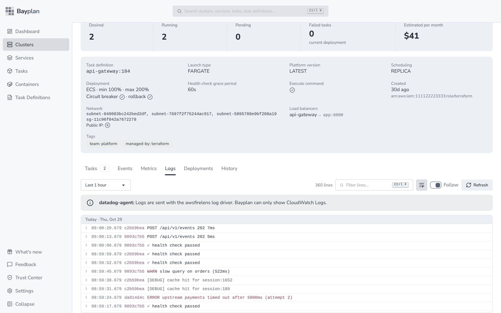
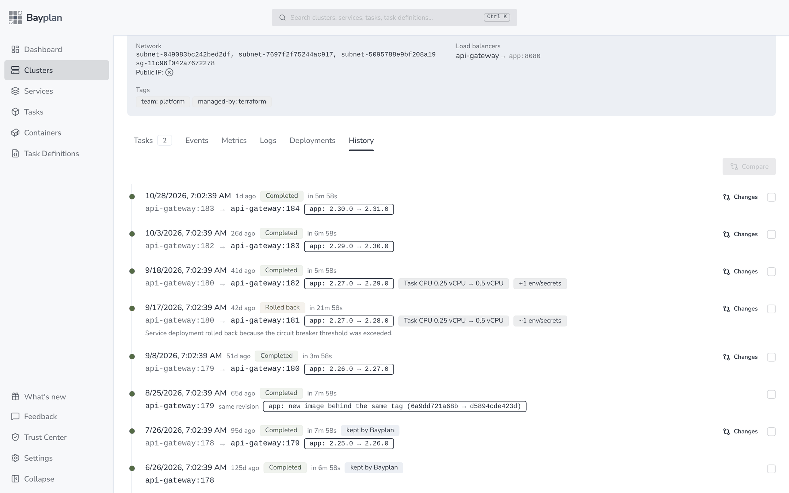
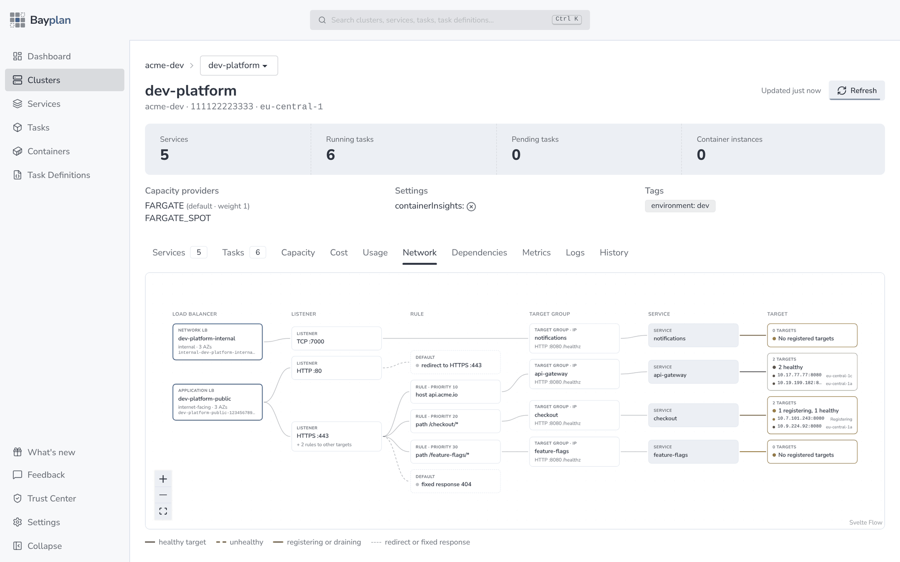
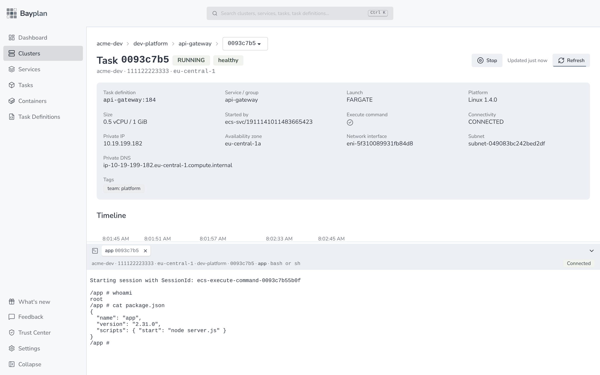
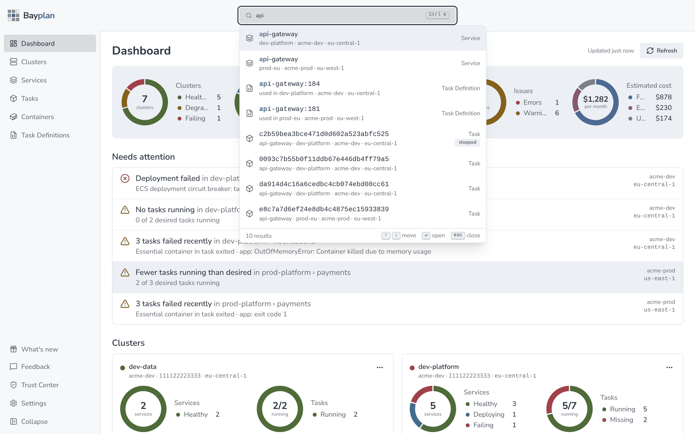

  

<h1 align="center">Bayplan</h1>

  <b>A fast desktop app for Amazon ECS.</b> 
  Every cluster, service and task across your AWS accounts and regions, in one window.

  <a href="https://bayplan.dev">Website</a> ·
  <a href="https://demo.bayplan.dev">Live demo</a> ·
  <a href="https://bayplan.dev/blog">Blog</a> ·
  <a href="https://bayplan.dev/tools">Free ECS tools</a>

---

Bayplan replaces clicking through the AWS console region by region. It reads your existing AWS profiles and SSO logins, talks to AWS directly from your machine and never sends your credentials or data anywhere else. Available for macOS, Windows and Linux.

### See what needs attention

The dashboard sums up every cluster and lists what is broken right now: failed deployments, crashing tasks and services that are short on tasks.

<picture>
  <source media="(prefers-color-scheme: dark)" srcset="images/dark-dashboard.png">
  
</picture>

### Metrics and logs where you need them

CPU and memory per service, used against reserved, and CloudWatch logs from all tasks in one view with live follow and filtering.

<picture>
  <source media="(prefers-color-scheme: dark)" srcset="images/dark-metrics.png">
  
</picture>

<picture>
  <source media="(prefers-color-scheme: dark)" srcset="images/dark-logs.png">
  
</picture>

### Know what changed

Every deployment of a service on a timeline, with the image and task definition changes that came with it and rollbacks marked.

<picture>
  <source media="(prefers-color-scheme: dark)" srcset="images/dark-history.png">
  
</picture>

### Follow traffic to your tasks

From load balancer to listener, rule, target group, service and healthy or draining target, drawn as one map per cluster.

<picture>
  <source media="(prefers-color-scheme: dark)" srcset="images/dark-network.png">
  
</picture>

### Open a shell in any container

ECS Exec built in: pick a running container and get a terminal, without the AWS CLI or the Session Manager plugin.

<picture>
  <source media="(prefers-color-scheme: dark)" srcset="images/dark-exec.png">
  
</picture>

### Find anything

Search clusters, services, tasks and task definitions across all accounts and regions with <kbd>Ctrl</kbd> <kbd>K</kbd>.

<picture>
  <source media="(prefers-color-scheme: dark)" srcset="images/dark-search.png">
  
</picture>

---

### Open source from Bayplan

- [awesome-ecs](https://github.com/bayplan-dev/awesome-ecs) - A curated list of tools, guides and resources for Amazon ECS and AWS Fargate.

Screenshots use demo data. Bayplan is not affiliated with Amazon Web Services.
